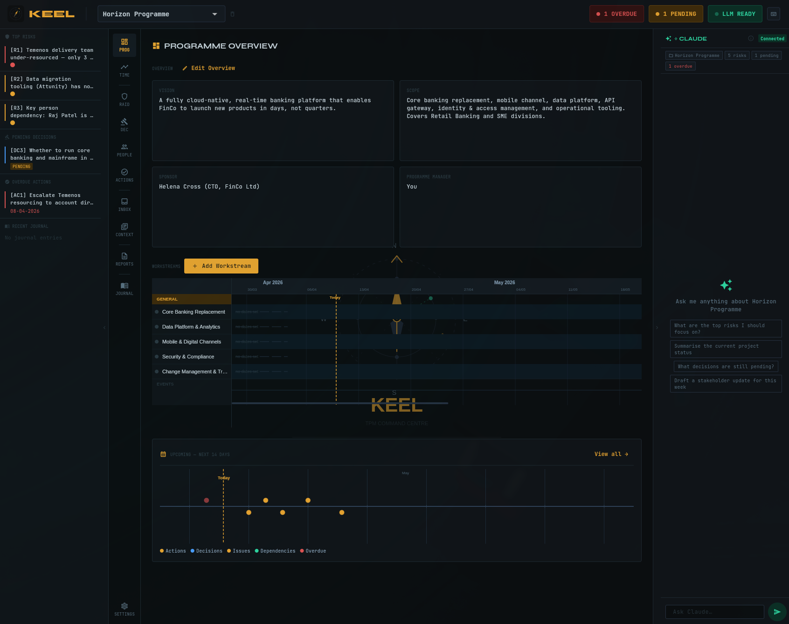

# Keel

A local-first command centre for Project, Programme and Portfolio Managers. Manage your programme, track RAID logs, decisions, actions, people, and journal — all stored on your machine, with optional encrypted sync across devices.

Built with Flutter for Linux, macOS, and Windows.



Keel demo:

[](https://www.youtube.com/watch?v=_0Fi8mchGss)

---

## Features

- **Programme Overview** — workstream tracking with Gantt chart timeline
- **RAID Log** — Risks, Assumptions, Issues, Dependencies
- **Decisions** — decision register with rationale and outcomes
- **Actions** — task tracking with categories, assignees, and due dates
- **People** — team directory with roles and contact details
- **Inbox** — file watcher and AI-assisted item triage
- **Context** — entries, document library, and glossary
- **Journal** — daily notes with Vim mode and slash commands
- **Playbook** — reusable stage templates for programme delivery
- **Reports** — programme status exports
- **Encrypted sync** — end-to-end encrypted cross-device sync via [keel-app.dev](https://keel-app.dev)
- **LLM integration** — Claude, OpenAI, Grok, GitHub Models, Azure OpenAI, Ollama
- **Keyboard-driven** — Doom Emacs-style leader key navigation (`SPC`)

---

## Download

Grab the latest release for your platform from the [Releases](../../releases/latest) page.

| Platform | Download                                                              |
| -------- | --------------------------------------------------------------------- |
| Windows  | `keel-windows-setup.exe` (installer) or `keel-windows.zip` (portable) |
| macOS    | `keel-macos.dmg`                                                      |
| Linux    | `keel-linux.tar.gz`                                                   |

### Releasing (maintainers)

Tag `vX.Y.Z` after bumping `pubspec.yaml`. GitHub Actions builds Linux and Windows. Start the macOS build on Codemagic by hand (from the tag, or from master; it attaches to the latest tag). Codemagic needs, in the `apple_credentials` group: the App Store Connect API key variables and `CERTIFICATE_PRIVATE_KEY`, an RSA private key in PEM form used to fetch the Developer ID Application certificate. Generate it once and keep it (both files are gitignored):

```bash
ssh-keygen -t rsa -b 2048 -m PEM -f codemagic_private_key -q -N ""
cat codemagic_private_key   # paste as CERTIFICATE_PRIVATE_KEY (secure)
```

The Developer ID Application certificate itself must be created once by hand. Apple only lets the Account Holder create Developer ID certificates, so the App Store Connect API (and therefore the pipeline) cannot; it returns 403 "This operation can only be performed by the Account Holder". Make a CSR from the same key and upload it:

```bash
openssl req -new -key codemagic_private_key \
  -out keel-developer-id.certSigningRequest -subj "/CN=Keel"
```

Then, signed in to developer.apple.com as the Account Holder: Certificates → + → Developer ID Application → upload the CSR → Continue. Nothing needs installing locally; the pipeline downloads the certificate that matches `CERTIFICATE_PRIVATE_KEY` on every build. Apple caps a team at five Developer ID Application certificates, so revoke a stale one if the portal refuses. Certificates issued now come from Apple's G2 authority and are valid for one year, so expect to repeat this step annually.

To confirm a certificate was issued from this key, download its `.cer` from the portal and compare public-key hashes; they must be identical:

```bash
openssl x509 -inform DER -in developerID_application.cer -noout -pubkey | openssl md5
openssl rsa -in codemagic_private_key -pubout 2>/dev/null | openssl md5
```

The pipeline fails rather than ship an unnotarized build.

### Installation

**Windows (installer)**
Run `keel-windows-setup.exe`. Installs to `AppData\Local\Programs\Keel` with Start Menu entry and uninstaller. No admin rights required.

**Windows (zip)**
Extract `keel-windows.zip` and run `keel.exe` from the folder. Use this if the installer is blocked by your organisation's security policy.

**macOS**
Open `keel-macos.dmg`, drag Keel to your Applications folder, then open it from Applications.

The app and the disk image are signed with a Developer ID and notarized by Apple, so macOS opens Keel without the "unidentified developer" block. If an older download is blocked, System Settings → Privacy & Security → Open Anyway.

**Linux**

```bash
tar -xzf keel-linux.tar.gz
cd keel
./install.sh
```

Installs to `~/.local/share/keel/`, creates an app launcher entry, and adds `keel` to your PATH. No root required.

---

## Keyboard Shortcuts

Keel uses a Doom Emacs-style leader key. Press `Space` to activate, then:

| Keys           | Action                   |
| -------------- | ------------------------ |
| `SPC SPC`      | Programme overview       |
| `SPC t`        | Timeline                 |
| `SPC r r`      | RAID › Risks             |
| `SPC r a`      | RAID › Assumptions       |
| `SPC r i`      | RAID › Issues            |
| `SPC r d`      | RAID › Dependencies      |
| `SPC d`        | Decisions                |
| `SPC d n`      | New decision             |
| `SPC p`        | People                   |
| `SPC a`        | Actions                  |
| `SPC i`        | Inbox                    |
| `SPC c e`      | Context › Entries        |
| `SPC c d`      | Context › Documents      |
| `SPC c g`      | Context › Glossary       |
| `SPC R`        | Reports                  |
| `SPC j`        | Journal                  |
| `SPC P`        | Playbook                 |
| `Ctrl+j`       | Open journal (new entry) |
| `Ctrl+Shift+j` | Open journal (history)   |

Append `n` to most section shortcuts to open the new item form directly (e.g. `SPC r r n` → new risk).

---

## Development

**Prerequisites**

- Flutter SDK (stable channel)
- For Linux: `libsecret-1-dev`, `libgtk-3-dev`

```bash
git clone https://github.com/paulhmurray/keel.git
cd keel
flutter pub get
flutter run -d linux   # or macos / windows
```

**Database code generation** (after schema changes):

```bash
dart run build_runner build --delete-conflicting-outputs
```

---

## Sync Server

The optional sync server lives in `/server` and is deployed on [Fly.io](https://fly.io).

```bash
cd server
fly deploy
```

---

## License

MIT — see [LICENSE](LICENSE).
